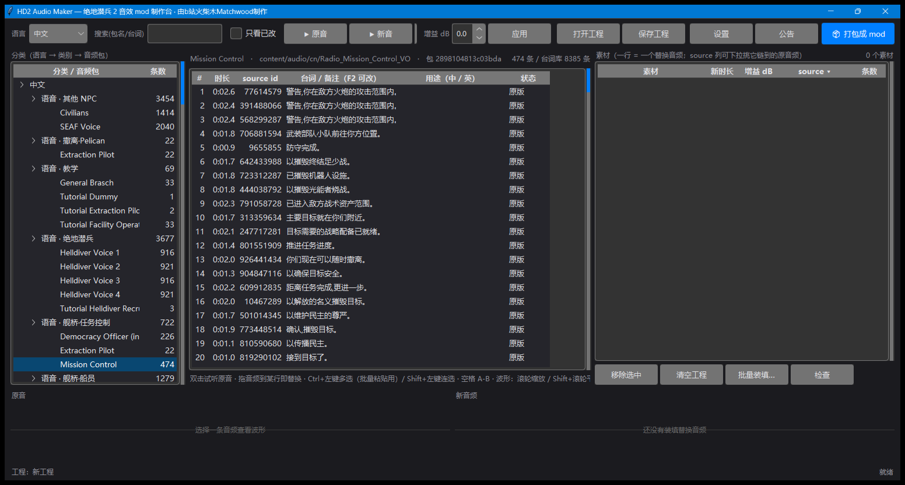
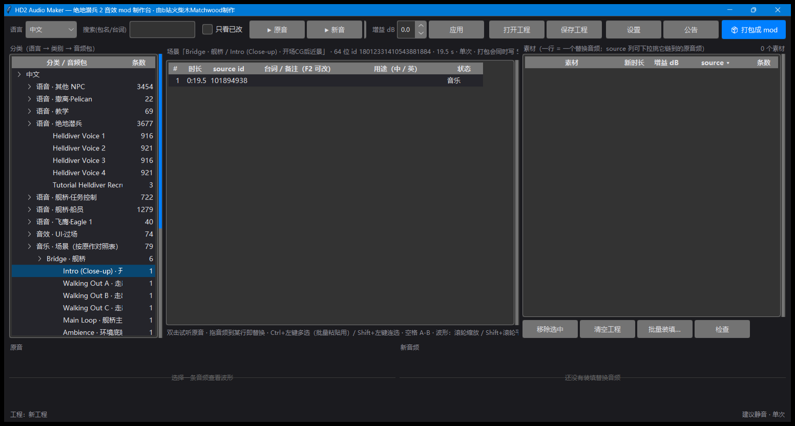
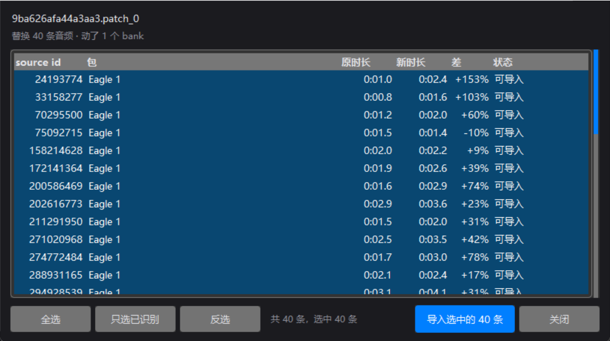
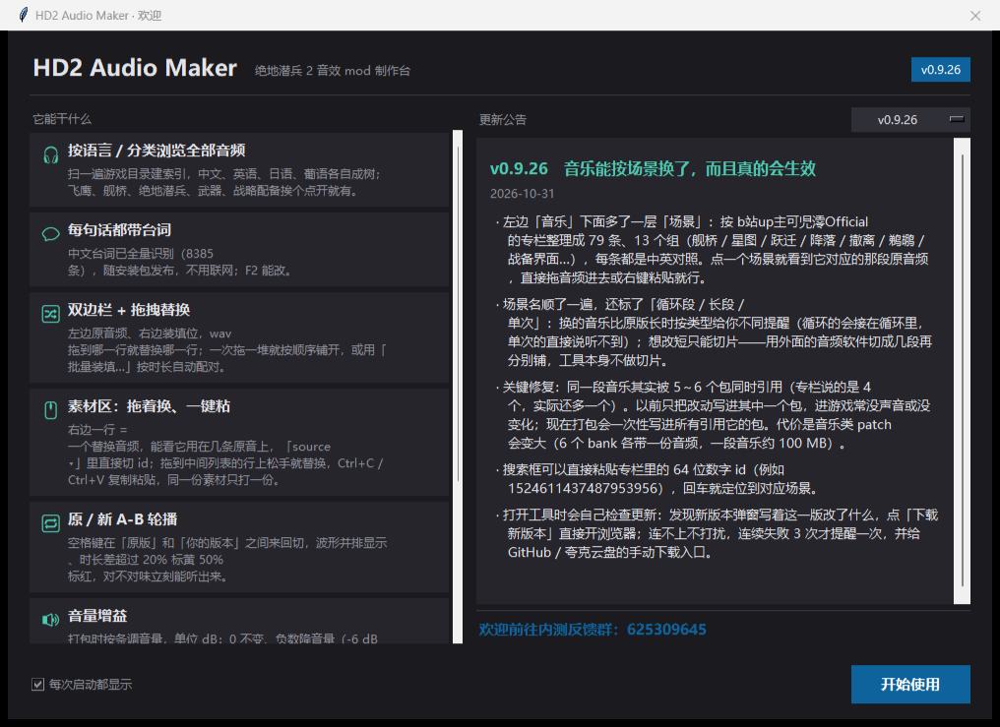
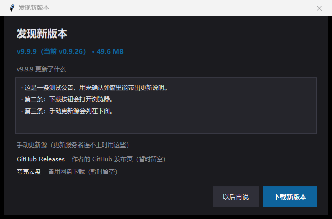

# HD2 Audio Maker

**《绝地潜兵 2》音效 mod 制作台** —— 把游戏里全部音频摊开成一张能搜、能听、能换、能一键打成 mod 的桌子。

> Helldivers 2 audio mod workbench: full audio index, scene-based music replacement, one-click patch packaging.
> Built on top of [hd2-audio-modder](https://github.com/RaidingForPants/hd2-audio-modder)'s Wwise bank engine.

[](https://github.com/nixiangshizhen/HD2-Audio-Maker/releases/latest)
[](#环境要求)
[](NOTICE.md)



---

## 它是什么

游戏里的音频分散在 401 个 Wwise 包里：同一个音源被多个包重复引用，文件名是纯数字 ID，没有任何可读线索。
这个工具做了三件事：

1. **扫一遍就全有了** —— 401 包 / 456 bank / **145,631 条音频（约 125 小时）**，按「语言 → 用途 → 分类 → 音频包」四层下钻，敌人按族/单位细分，武器按枪械类别归类并显示中文枪名。
2. **每句话都有字** —— 8,385 条中文台词离线识别好随包发布，直接看这句说了什么；搜索框同时搜包名和台词。
3. **改完真的会响** —— 一段音乐在游戏里常被 **5～6 个包同时引用**，只改一个包等于没改（进游戏没声音）。打包时会算出全部引用包一次写进去。

## 核心能力

| 级别 | 能力 |
|---|---|
| **主线** | 全量音频索引（145,631 条 / 125 小时）· 每句台词带中文文本 · 一键打包成一对 patch（含全引用打包） |
| **进阶** | 音乐按「场景」替换（79 个场景 / 13 组，带循环段标签）· 直接导入别人做好的 mod（`.patch_0` / zip / 7z / rar）· 视频过场替换（183 条，mp4 → bk2）· 拖拽替换 + 批量装填 · 内置解码引擎（不需要 ffmpeg） |
| **点缀** | 启动自动检查更新 · 开屏公告 · 安装版/便携版 · 自检（`--selftest`）· 打包洁净闸门 |

### 音乐按场景换



79 个场景（舰桥 / 星图 / 跃迁 / 降落 / 鹈鹕 / 战备界面 …）来自社区对照表，每条标了用途、是否循环段、风险等级。
点一个场景就看到它对应的那段原音频，拖音频进去或右键粘贴即可。

### 直接导入别人的 mod



拖进一个 `.patch_0`（或压缩包），列出它替换了哪些 source、各自原长/新长与偏差，勾选后导入到工程继续改。

### 开屏公告与在线更新

<p>


</p>

启动时后台静默检查更新；发现新版本才弹窗（附本版公告与「下载新版本」）；连续失败 3 次才提醒一次，并给出手动下载源。

## 下载

到 [Releases](https://github.com/nixiangshizhen/HD2-Audio-Maker/releases/latest) 下载：

| 文件 | 用途 |
|---|---|
| `HD2AudioMaker-Setup-<版本>.exe` | 安装版（用户级安装，不需要管理员，注册到「已安装的应用」） |
| `HD2AudioMaker-portable-<版本>.zip` | 便携版（解压即用，不写注册表；整个文件夹拷走即带走全部数据） |

每个 Release 的正文里都写了该版本两个文件的 SHA-256，下载后可校验。

## 快速开始

1. 启动 → **第一次**会扫一遍游戏音频建索引（约 1 分钟，只需一次）。
2. 左侧选 **语言 → 分类 → 音频包**，中间列出这个包里每一条音频。
3. 把 `wav/mp3/ogg/flac/m4a` 拖到中间某一行 → 这一行变成「已替换」；右键可复制/粘贴替换、`Ctrl+左键`多选后批量粘贴。
4. 双击试听原音，`空格` 在原音/新音之间切（最快确认对味的方式）；底部波形条并排对比，时长差过大有颜色提示。
5. 点 **打包成 mod** → 得到一对 `patch_0` + `.patch_0.stream`（也可导出成 zip），丢给 mod 管理器使用。

## 环境要求

- **Windows 10 / 11 x64**
- **正版《绝地潜兵 2》**（Steam），程序会自动从注册表/libraryfolders 里找游戏目录，也可在「设置」里手动指定
- **Wwise 2025.1.x**：只有「打包成 mod」需要（要把音频压成 Wwise Vorbis）。没安装时打包按钮会置灰并给出下载页，其它功能不受影响
- 不需要 Python、不需要 ffmpeg —— 解码引擎与解压组件随包发布

## 打包原理（为什么有时 patch 很大）

Wwise 的 `AudioSource.resource_id = murmur64("content/audio/<source_id>")`。
一段音乐常常挂在 5～6 个 bank 上（舰桥/任务/虫族/光能者…各一份），每个 bank 各自内嵌音频。
只要有一个包没同步，游戏就可能从旧包播放 → 「改了没声音」。

所以打包时会：

1. 由 `source_id` 反算 `resource_id`，查出**所有**引用它的 bank 与 archive；
2. 把它们全部写进同一个 patch；
3. 对同一素材只转码一次、只写一份数据。

代价是音乐类 patch 会变大（6 个 bank 各带一份音频，一首曲子约 100 MB）；好处是进游戏一定生效。

## 已知限制

- **只能替换已有音频，不能新增音源**（游戏没有的条目无法凭空创建）。
- 音乐/视频 patch 体积较大（媒体内嵌在 bank 里）。
- 台词是 ASR 自动识别，个别句子可能有错字；用 `F2` 可以自己改，改完保存在本地。
- 游戏大版本更新后建议在「设置」里重建一次索引。

## 杀软误报（先看这里）

程序用 PyInstaller 打包、没有代码签名，个别杀软（尤其 BitDefender 引擎家族的 ALyac / Arcabit / Emsisoft / eScan / GData / VIPRE）会报
`Gen:Variant.Giant.Tedy` / `Trojan.Giant.Tedy` 之类的名字 —— 这是「未签名 + 内嵌解释器 + 安装器释放大量文件」的典型启发式误报。

自证方式：核对 Release 正文里的 SHA-256；不放心就先用**便携版 zip**（不写注册表、不建快捷方式、不解包到 `%TEMP%`）。
程序只读写自己的目录，联网只有「检查更新」一处（失败静默）。

## 从源码运行 / 构建

```powershell
python -m venv .venv
.\.venv\Scripts\pip install -r requirements.txt
.\.venv\Scripts\python -m hd2_audio_maker              # 运行
.\.venv\Scripts\python -m hd2_audio_maker --selftest   # 自检（写 selftest.log）
```

构建发布包（需要 Wwise、PyInstaller、7-Zip 组件）：

```powershell
.\.venv\Scripts\python tools\build_installer.py   # dist\HD2AudioMaker-Setup-<ver>.exe
.\.venv\Scripts\python tools\build_portable.py    # dist\HD2AudioMaker-portable-<ver>.zip
.\.venv\Scripts\python tools\publish_index.py     # dist\update.json（在线更新清单）
```

开发记录与改动理由见仓库内 `DEVLOG.md`（不随发布包分发）。

## 致谢

- [hd2-audio-modder](https://github.com/RaidingForPants/hd2-audio-modder) —— Wwise bank 解析与打包引擎（本项目的底座）
- **b站up主 可児澪Official** —— 音乐场景对照表（79 条场景的来源）
- 社区里的音频 ID / 武器 ID / bank 对照表作者们
- 7-Zip、vgmstream 等开源组件（许可见 [NOTICE.md](NOTICE.md)）

游戏音频版权归 Arrowhead Game Studios 所有；本项目只处理用户本机上的游戏文件，不附带任何游戏资源。

## 反馈

- B 站：**火柴木Matchwood**
- 内测反馈群：**625309645**
- Issue：<https://github.com/nixiangshizhen/HD2-Audio-Maker/issues>
